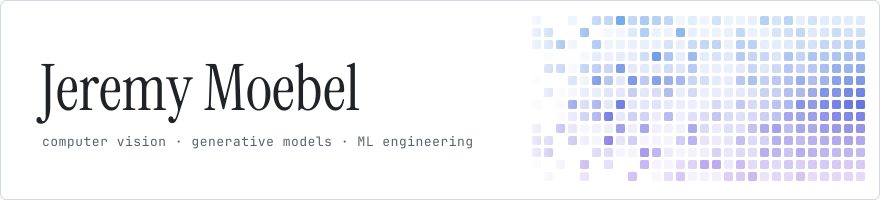

<picture>
  <source media="(prefers-color-scheme: dark)" srcset="assets/banner-dark.svg">
  
</picture>

I'm an engineering student at École des Ponts and in the M2 Data Science at Institut Polytechnique de Paris. I work on computer vision and generative models.

Previously: research internship at the Harvard AI and Robotics Lab, applied AI engineering at Auditoo (Station F).

### Research

- [Revision-Aware Independent Agent Graphs for Dynamic Reasoning](https://arxiv.org/abs/2610.01249) · arXiv 2026
- [Rethinking One-Step Image Editing through ChordEdit: Reproduction, Simplification, and New Insights](https://arxiv.org/abs/2606.14042) · arXiv 2026
- [VAGS: Velocity Adaptive Guidance Scale for Image Editing and Generation](https://arxiv.org/abs/2605.15661) · arXiv 2026

### Tools

<picture>
  <source media="(prefers-color-scheme: dark)" srcset="https://skillicons.dev/icons?i=py%2Cpytorch%2Copencv%2Csklearn%2Cdocker%2Cts%2Cswift%2Clatex&theme=dark">
  
</picture>

I also arrange piano music: [jeremymoebelsheetmusic.com](https://jeremymoebelsheetmusic.com)

<picture>
  <source media="(prefers-color-scheme: dark)" srcset="https://raw.githubusercontent.com/jeremymbl/jeremymbl/output/snake-dark.svg">
  
</picture>

